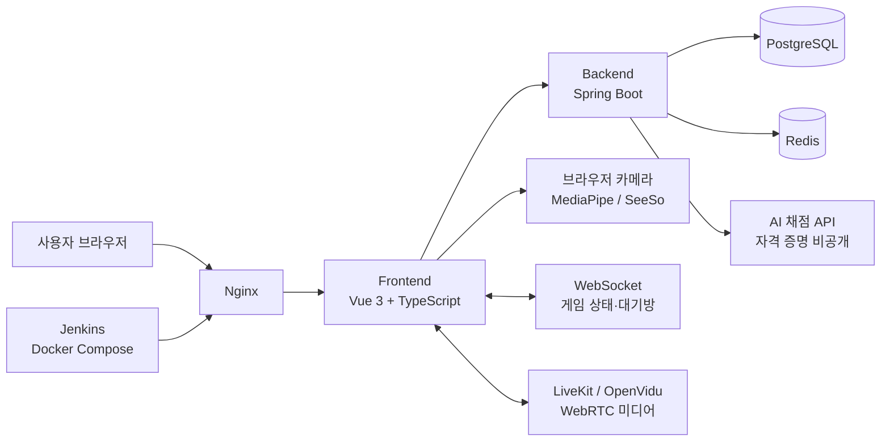

# eye-dont-care

> 카메라 하나로 시선과 눈 깜빡임을 게임 컨트롤러처럼 사용하는 브라우저 기반 미니게임 플랫폼

`eye-dont-care`는 별도의 컨트롤러나 센서 없이 웹캠만으로 플레이할 수 있는 시선·눈동작 인식 게임 서비스입니다. 사용자는 시선으로 패들을 움직이고, 눈을 뜨고 버티고, 눈으로 그림을 그리며, 박자에 맞춰 눈을 깜빡일 수 있습니다.

이 저장소는 SSAFY 프로젝트 정책에 따라 소스 코드와 운영 환경 설정을 공개하지 않고, 서비스의 기획·기능·아키텍처·화면 결과물을 포트폴리오 목적으로 정리한 공개용 저장소입니다.

<p align="center">
  
  
</p>

## 목차

- [프로젝트 한눈에 보기](#프로젝트-한눈에-보기)
- [기획 배경](#기획-배경)
- [주요 기능](#주요-기능)
- [게임별 상세](#게임별-상세)
- [사용자 이용 흐름](#사용자-이용-흐름)
- [서비스 화면](#서비스-화면)
- [기술 스택](#기술-스택)
- [시스템 아키텍처](#시스템-아키텍처)
- [핵심 기술 구현](#핵심-기술-구현)
- [문제 해결 및 설계 포인트](#문제-해결-및-설계-포인트)
- [공개 범위 및 실행 안내](#공개-범위-및-실행-안내)
- [팀원 및 담당 영역](#팀원-및-담당-영역)
- [향후 개선 방향](#향후-개선-방향)

## 프로젝트 한눈에 보기

| 항목 | 내용 |
| --- | --- |
| 서비스명 | eye-dont-care |
| 서비스 형태 | 웹캠 기반 브라우저 미니게임 플랫폼 |
| 핵심 입력 | 시선 좌표, 눈 뜸·감김 상태, 눈 깜빡임 |
| 플레이 방식 | 솔로, AI 대결, 친구 대결, 랜덤 매칭 |
| 주요 사용자 | 새로운 입력 방식의 게임을 경험하고 싶은 사용자 |
| 배포 서비스 | [eyedontcare.shop](https://eyedontcare.shop) |
| 공개 저장소 범위 | README, 화면 캡처, 포트폴리오 설명 자료 |

### 한 줄 소개

눈으로 조작하고, 눈으로 경쟁하고, 눈으로 기록하는 웹 기반 캐주얼 게임 서비스입니다.

### 핵심 가치

- **접근성**: 키보드·마우스·별도 센서 없이 웹캠만으로 플레이
- **새로운 상호작용**: 시선과 눈동작을 게임 입력으로 활용
- **짧은 플레이 경험**: 준비부터 결과 확인까지 빠르게 이어지는 미니게임 구조
- **확장 가능한 경쟁 구조**: 솔로 기록, AI 대결, 친구 초대, 랜덤 매칭 지원
- **기록과 커뮤니티**: 게임 결과를 랭킹·프로필에 남기고 소모임에서 공유

## 기획 배경

일반적인 웹게임은 키보드와 마우스를 전제로 합니다. `eye-dont-care`는 “웹캠만으로도 게임을 조작할 수 있다면 어떤 경험이 가능할까?”라는 질문에서 출발했습니다.

시선과 눈 깜빡임은 별도의 학습 없이 누구나 사용할 수 있는 자연스러운 움직임입니다. 이를 단순한 인식 데모로 끝내지 않고, 다음과 같이 서로 다른 게임 규칙으로 확장했습니다.

1. 시선 좌표를 연속적인 조작값으로 사용하기
2. 양쪽 눈의 상태를 판정해 게임 이벤트로 변환하기
3. 눈 깜빡임을 타격·리듬·기록 입력으로 사용하기
4. 인식 결과를 실시간 게임 상태와 연결하기
5. 게임 결과를 저장해 랭킹과 프로필에서 다시 확인하기

## 주요 기능

### 1. 계정 및 사용자 기능

- 이메일 기반 회원가입·로그인
- 카카오 OAuth 로그인
- JWT 기반 인증 및 토큰 재발급
- 로그인하지 않은 사용자를 위한 게스트 세션
- 프로필 이미지·닉네임 관리
- 비밀번호 변경 및 회원 탈퇴
- 로그인 상태에 따른 메뉴·페이지 접근 제어

게스트도 게임을 체험할 수 있도록 진입 장벽을 낮추고, 로그인 사용자는 게임 기록·랭킹·프로필 기능을 계속 사용할 수 있도록 구분했습니다.

### 2. 게임 탐색 및 준비

- 5종 게임 목록 및 게임 상세 페이지
- 게임 규칙·권장 인원·예상 시간·지원 모드 안내
- 솔로·AI·친구·랜덤 매칭 모드 선택
- 게임 시작 전 카메라 권한 안내
- 카메라 미리보기 및 연결 상태 표시
- 눈 상태 캘리브레이션
- 게임 시작 카운트다운
- 카메라 오류·연결 실패·이탈 상황 안내

### 3. 실시간 대결

- 친구 초대코드로 대기방 생성 및 참가
- 랜덤 매칭 대기 및 자동 매칭
- 대기방 참가자·준비 상태 동기화
- 실시간 게임 상태 및 점수 동기화
- 상대방 카메라·음성 통신
- 상대방 이탈 시 몰수승 및 결과 처리
- 양쪽 플레이어의 재플레이 동의 처리

### 4. 결과·랭킹·커뮤니티

- 게임별 결과 화면
- 승리·패배·무승부·상대 이탈 결과 구분
- 게임별 기록 및 점수 저장
- 주간 랭킹과 순위 변동 표시
- 프로필에서 게임 기록·상대·결과 확인
- 길드 목록·생성·가입·검색
- 길드 게시글·댓글 작성·수정·삭제
- 알림 및 환경 설정

## 게임별 상세

| 게임 | 플레이 방식 | 주요 모드 | 핵심 경험 |
| --- | --- | --- | --- |
| **Eye Hockey** | 시선으로 패들을 이동하고 눈 깜빡임으로 퍽을 타격 | AI·친구·랜덤 | 시선 조작과 실시간 반응 |
| **Eye See** | 눈을 뜬 상태를 유지하며 상대보다 오래 버티기 | 솔로·AI·친구·랜덤 | 집중력과 눈 상태 인식 |
| **Eye Draw** | 시선으로 캔버스에 그림을 그리고 AI 채점 받기 | AI | 시선 좌표와 이미지 인식의 결합 |
| **Blink the Beat** | 양쪽 눈 입력으로 리듬 노트를 맞추기 | 솔로·친구·랜덤 | 리듬·콤보·정확도 |
| **Eye Show Speed** | 제한 시간 동안 눈 깜빡임을 최대한 정확하게 기록 | 솔로·친구·랜덤 | 짧은 시간 안의 순발력 |

### Eye Hockey

시선의 가로 위치를 패들의 이동값으로 사용합니다. 플레이어는 시선으로 패들을 움직여 퍽의 위치를 방어하고, 눈 깜빡임을 활용해 퍽을 타격합니다.

- AI 상대와의 연습 대결
- 친구·랜덤 매칭 기반 실시간 대결
- 플레이어별 점수와 남은 시간 표시
- AI 상대 카드와 플레이어 카메라 카드 제공
- 실시간 퍽·점수 동기화

### Eye See

카메라로 얼굴과 양쪽 눈 상태를 확인한 뒤 눈을 뜨고 버티는 시간을 측정합니다. AI 대결에서는 AI의 목표 생존 시간보다 오래 버티면 승리합니다.

- 눈 뜬 상태·눈 감은 상태 샘플 기록
- 카메라 연결 및 캘리브레이션 상태 표시
- 현재 생존 시간 HUD
- AI 상대 패널 및 집중 상태 표시
- 친구 대결에서 상대 생존 시간 동기화
- 눈 감김·얼굴 미검출·판정 불명확 상태 처리

### Eye Draw

화면에 제시된 단어를 시선으로 따라 그립니다. 그려진 캔버스 이미지를 AI 채점 API로 전달해 인식 결과와 점수를 확인합니다.

- 라운드별 제시어와 진행 상태 표시
- 시선 기반 커서 및 캔버스 입력
- 펜 색상·펜 속도 조절
- 되돌리기·전체 지우기
- 라운드 제출 및 AI 채점 결과 모달
- AI 인식 결과·정답 여부·점수·신뢰도 표시

### Blink the Beat

리듬에 맞춰 왼쪽 눈과 오른쪽 눈을 구분해 깜빡입니다. 입력된 눈 상태에 따라 노트 판정이 이루어지고, 콤보·정확도·체력으로 플레이 결과를 보여줍니다.

- 왼쪽·오른쪽 눈 전용 리듬 레인
- 노트 도착과 판정 피드백
- PERFECT·GOOD·MISS 계열 판정
- 콤보 및 정확도 표시
- 제한 시간과 체력 관리
- 솔로 및 실시간 대결 결과 저장

### Eye Show Speed

20초 동안 자연스럽게 눈을 깜빡이며 횟수를 기록합니다. 단순 횟수 경쟁이지만 카메라 인식 상태와 제한 시간이 함께 표시되어 짧고 직관적으로 즐길 수 있습니다.

- 20초 제한 시간
- 실시간 깜빡임 횟수 표시
- 카메라 연결 상태 표시
- 제한 시간 종료 후 자동 기록
- 재플레이 및 결과 확인

## 사용자 이용 흐름

```text
서비스 접속
    ↓
로그인 또는 게스트 세션
    ↓
게임 목록
    ↓
게임 상세 및 게임 모드 선택
    ↓
카메라 연결
    ↓
눈 상태·시선 캘리브레이션
    ↓
준비 완료 및 카운트다운
    ↓
게임 플레이
    ↓
결과 저장
    ↓
결과 화면 · 랭킹 · 프로필 기록
```

### 친구 대결 흐름

```text
방 생성
  → 초대코드 공유
  → 상대방 코드 입력
  → 양쪽 카메라 연결
  → 양쪽 준비 완료
  → 게임 시작
  → 실시간 상태·점수·미디어 통신
  → 결과 저장
```

### 랜덤 매칭 흐름

```text
랜덤 매칭 선택
  → 매칭 대기 WebSocket 연결
  → 상대방 탐색
  → 대기방 자동 입장
  → 준비 상태 동기화
  → 게임 시작 및 결과 저장
```

## 서비스 화면

### 로그인 후 서비스 UI

실제 배포 서비스에 로그인한 상태에서 캡처한 화면입니다.

<details open>
<summary>홈 · 게임 목록</summary>

<p align="center">
  
  
</p>
</details>

<details>
<summary>랭킹 · 커뮤니티 · 프로필</summary>

<p align="center">
  
  
  
</p>
</details>

### 실제 게임 플레이 UI

게임 선택 화면이 아니라 실제 플레이 라우트에서 캡처한 화면입니다.

<details open>
<summary>게임 플레이 화면 모음</summary>

#### Eye See AI 대결


내 카메라 영역, AI 상대 영역, 생존 시간, 현재 판정 상태를 한 화면에서 확인할 수 있습니다.

#### Eye Hockey AI 대결


점수·남은 시간·하키 보드·AI HOCKEY BOT·플레이어 카메라 영역으로 구성된 실시간 대결 화면입니다.

#### Eye Draw AI 대결


제시어·라운드 진행·캔버스·펜 도구·AI 제출·플레이어 카메라 영역을 포함합니다.

#### Blink the Beat 솔로


점수·콤보·시간·왼쪽 눈 레인·오른쪽 눈 레인·정확도·카메라 영역을 확인할 수 있습니다.

#### Eye Show Speed 솔로


남은 시간·깜빡임 횟수·TIP·카메라 상태가 단순한 구조로 표시됩니다.
</details>

### 주요 인터랙션 화면

| 화면 | 설명 |
| --- | --- |
| [게임 상세 모달](./portfolio-screenshots/18-game-description-dialog.png) | 게임 규칙·진행 방식 안내 |
| [친구 대결 방](./portfolio-screenshots/19-friends-room-dialog.png) | 방 생성 및 초대코드 참가 |
| [로그인 모달](./portfolio-screenshots/20-login-dialog.png) | 로그인 진입 화면 |
| [카메라 준비 화면](./portfolio-screenshots/22-calibration-camera-dialog.png) | 카메라 연결 및 캘리브레이션 진입 |
| [회원가입 모달](./portfolio-screenshots/25-signup-dialog.png) | 회원가입 입력 화면 |
| [커뮤니티 생성](./portfolio-screenshots/26-community-create-dialog.png) | 소모임 생성 화면 |
| [커뮤니티 참가](./portfolio-screenshots/27-community-join-dialog.png) | 초대코드 참가 화면 |
| [게시글 작성](./portfolio-screenshots/28-community-post-composer.png) | 커뮤니티 게시글 작성 화면 |

## 기술 스택

### Frontend

- Vue 3
- TypeScript
- Vite
- Pinia
- Vue Router
- MediaPipe Tasks Vision
- SeeSo(Eyedid) SDK
- LiveKit Client

### Backend

- Java 25
- Spring Boot 4.1
- Gradle
- Spring Data JPA
- PostgreSQL 15
- Redis 7
- WebSocket

### Infrastructure 및 외부 연동

- Docker / Docker Compose
- Nginx
- Jenkins CI/CD
- LiveKit·OpenVidu 기반 WebRTC 미디어 통신
- Kakao OAuth 2.0
- AI 채점 API
- Mattermost Webhook

## 시스템 아키텍처



### 데이터 및 이벤트 흐름

1. 브라우저가 카메라 권한을 받고 얼굴·눈 상태 또는 시선 좌표를 수집합니다.
2. 인식 결과를 게임별 입력 이벤트로 변환합니다.
3. 게임 화면은 입력 이벤트를 이용해 패들·캔버스·리듬 레인·생존 상태를 갱신합니다.
4. 친구·랜덤 대결에서는 WebSocket으로 대기방·게임 상태·점수를 동기화합니다.
5. 카메라·음성 등 미디어는 WebRTC 기반 통신으로 전달합니다.
6. 게임 종료 시 백엔드에 결과를 저장하고 결과·랭킹·프로필에서 조회합니다.
7. Eye Draw는 제출된 그림을 AI 채점 API에 전달하고 인식 결과를 결과 화면에 반영합니다.

## 핵심 기술 구현

### 1. 웹캠 입력을 게임 입력으로 추상화

게임마다 카메라를 직접 다르게 처리하지 않고, 카메라 스트림에서 얻은 공통 정보를 게임별 규칙에 맞는 이벤트로 변환하는 구조를 사용했습니다.

```text
카메라 스트림
  → 얼굴·눈 인식
  → 시선 좌표 / 눈 상태 / 깜빡임 이벤트
  → 게임별 룰 엔진
  → 화면 갱신·점수·결과 저장
```

이를 통해 같은 카메라 준비·권한·오류 처리 경험을 여러 게임에서 재사용할 수 있습니다.

### 2. 캘리브레이션과 인식 실패 처리

시선 입력은 사용자와 조명·카메라 위치에 따라 결과가 달라질 수 있습니다. 게임 시작 전에 눈 상태 샘플과 시선 보정을 진행하고, 다음 상태를 화면에 명확하게 표시했습니다.

- 카메라 연결 필요
- 카메라 연결 완료
- 얼굴 미검출
- 눈 상태 샘플 부족
- 캘리브레이션 진행 중
- 캘리브레이션 완료
- 카메라 연결 끊김 및 재연결 필요

### 3. 실시간 대결 상태 관리

대기방과 게임 플레이를 분리된 상태로 관리하고, 준비 상태·게임 시작·점수·상대 이탈·재플레이 동의 같은 이벤트를 실시간으로 전달합니다. 상대방의 연결 상태가 바뀌었을 때 결과가 잘못 저장되지 않도록 정상 종료와 이탈 종료를 구분했습니다.

### 4. AI 대결과 AI 채점 분리

AI가 상대가 되는 게임과 사용자의 결과물을 AI가 평가하는 게임을 분리했습니다.

- **AI 상대**: Eye See·Eye Hockey에서 AI 상태와 상대 패널을 별도로 표시
- **AI 채점**: Eye Draw에서 제출 그림을 외부 AI 채점 API로 전달
- **보안 처리**: API 키·환경변수·운영 엔드포인트는 공개 문서와 캡처에서 제외

### 5. 결과·랭킹·프로필 연결

게임이 끝난 뒤 결과를 단순히 한 번 보여주는 데 그치지 않고, 결과 데이터가 다음 기능으로 이어지도록 구성했습니다.

```text
게임 종료
  → 결과 저장
  → 결과 화면
  → 게임별 랭킹
  → 프로필 경기 기록
  → 주간 순위 변동
```

## 문제 해결 및 설계 포인트

### 카메라 권한과 브라우저 환경 차이

카메라 기능은 HTTPS·브라우저 권한·조명·카메라 위치의 영향을 받습니다. 준비 화면에서 카메라 연결 안내와 오류 상태를 분리하고, 게임 화면에서도 카메라 상태를 계속 확인할 수 있도록 했습니다.

### 시선 좌표의 좌우 반전과 화면 좌표 차이

카메라 미리보기와 화면 좌표계가 다르면 사용자가 보는 방향과 입력 방향이 반대로 느껴질 수 있습니다. 시선 좌표를 게임 영역의 좌표로 변환하는 단계를 두고, 좌우 방향 보정과 캔버스·게임 보드별 좌표 적용을 분리했습니다.

### 실시간 상태와 미디어 통신의 분리

게임 점수·준비 상태·게임 이벤트는 WebSocket, 카메라·음성은 WebRTC로 나누었습니다. 데이터 이벤트와 미디어 스트림의 성격을 분리해 각 통신 방식의 역할을 명확히 했습니다.

### 새로고침·이탈 상황의 결과 정합성

게임 도중 새로고침이나 상대방의 이탈이 발생하면 게임이 중복 시작되거나 잘못된 승패가 저장될 수 있습니다. 게임 입장 상태, 정상 종료, 상대방 이탈을 구분해 결과 저장 흐름을 제어했습니다.

## 공개 범위 및 실행 안내

### 공개 범위

SSAFY 프로젝트 정책과 인증 정보 보호를 위해 이 공개용 저장소에는 다음 자료만 포함합니다.

- 프로젝트 소개 및 기능 설명
- 화면 캡처
- 기술 스택 및 시스템 아키텍처 개요
- 사용자 흐름 및 기술 구현 설명

다음 자료는 공개하지 않습니다.

- Frontend·Backend 소스 코드
- `.env` 및 실제 환경변수
- AI 채점 API 키·라이선스 키
- 데이터베이스 계정·비밀번호
- 운영 서버 내부 주소·접속 정보
- CI/CD 자격 증명

### 배포 서비스 이용

배포가 유지되는 동안 [eyedontcare.shop](https://eyedontcare.shop)에서 서비스를 확인할 수 있습니다. 카메라 기반 기능은 HTTPS 환경과 브라우저 카메라 권한이 필요하며, 조명과 카메라 위치에 따라 인식 정확도가 달라질 수 있습니다.

### 실행 정보

전체 소스와 비공개 환경변수가 포함된 개발용 실행 방법은 공개하지 않습니다. 따라서 이 저장소는 실행 저장소가 아니라, 배포 결과와 프로젝트 산출물을 이해하기 위한 포트폴리오 저장소입니다.

## 팀원 및 담당 영역

아래 역할은 프로젝트 커밋과 기능 영역을 기준으로 정리한 공개용 요약입니다. 실제 포트폴리오 게시 전 팀 내부에서 이름·링크·세부 담당을 최종 확인해 주세요.

| 팀원 | 담당 영역 | 주요 기여 |
| --- | --- | --- |
| 정재현 | 서비스 통합·실시간 미디어·시선 기능 | LiveKit/WebRTC 미디어 제어, WebSocket 게임 세션, SeeSo 보정, 게스트 세션, AI 채점 연동, 배포·포팅 문서 |
| 장미지 | 인증·대기방·매칭·백엔드 | 카카오 OAuth·JWT 인증, 게스트 세션, 친구 초대방, 랜덤 매칭, 대기방 상태 동기화, 사용자 기능 및 운영 설정 |
| 김진광 | 랭킹·결과·커뮤니티·게임 동기화 | 랭킹과 순위 변동, 경기 결과·프로필 기록, 길드·게시글·댓글 API, 실시간 게임 점수·결과 정합성 |
| 김보경 | 프론트엔드 UI/UX·게임 보조 기능 | AI 상대 UI, 카메라·준비 상태 화면, 게임 사운드·BGM, 결과 화면, 커뮤니티 화면 개선 |
| 김태은 | 게임 플레이·결과 UI | 게임방·플레이 화면, 캘리브레이션 UX, 리듬 피드백, 게임 결과·무승부·재플레이 화면 |
| 박호진 | 게임 기능 협업·QA | 게임 기능 통합 및 품질 개선에 참여 |

## 향후 개선 방향

- 모바일 브라우저와 다양한 카메라 환경에 대한 인식 안정화
- 조명·얼굴 각도별 인식 품질 개선
- 게임별 튜토리얼과 접근성 옵션 강화
- AI 채점 결과의 설명력과 피드백 개선
- 실시간 대결 매칭 풀 확대
- 게임 결과 기반 업적·시즌·리더보드 확장
- 서비스 운영 지표와 오류 모니터링 강화
- 공개 가능한 범위의 API 명세·ERD·상세 아키텍처 자료 추가

## 포트폴리오 캡처 목록

전체 캡처는 [`portfolio-screenshots`](./portfolio-screenshots/) 폴더에서 확인할 수 있습니다.

| 구분 | 파일 |
| --- | --- |
| 로그인 후 홈·게임·랭킹·커뮤니티·프로필 | `eyedontcare-home-logged-in.png`, `eyedontcare-games-logged-in.png`, `eyedontcare-ranking-logged-in.png`, `eyedontcare-community-logged-in.png`, `eyedontcare-profile-logged-in.png` |
| 실제 게임 플레이 | `29-eye-see-ai-gameplay.png` ~ `33-eye-show-speed-solo-gameplay.png` |
| 주요 인터랙션 | `18-game-description-dialog.png` ~ `22-calibration-camera-dialog.png`, `25-signup-dialog.png` ~ `28-community-post-composer.png` |

---

Made with gaze, blink, and teamwork.
