# eye-dont-care 👀

**웹캠으로 시선과 눈 깜빡임을 인식해 플레이하는 브라우저 미니게임 플랫폼**

별도 컨트롤러 없이 시선으로 움직이고, 눈을 깜빡여 입력합니다. 혼자 기록을 세우거나 AI·친구·랜덤 상대와 대결하고, 결과를 랭킹과 프로필에서 확인할 수 있습니다.

| 프로젝트 | 내 역할 | 서비스 |
| --- | --- | --- |
| SSAFY 웹·모바일 프로젝트 | **게임 플레이·결과 UI 개발** | [eyedontcare.shop](https://eyedontcare.shop) |

<p align="center">
  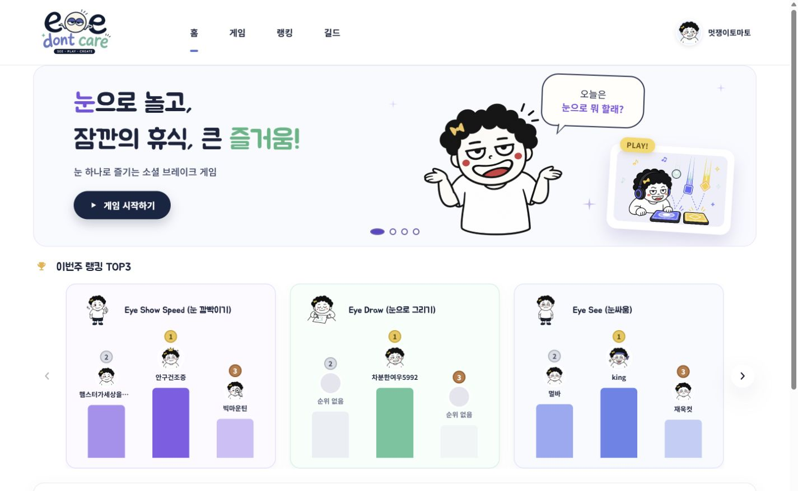
  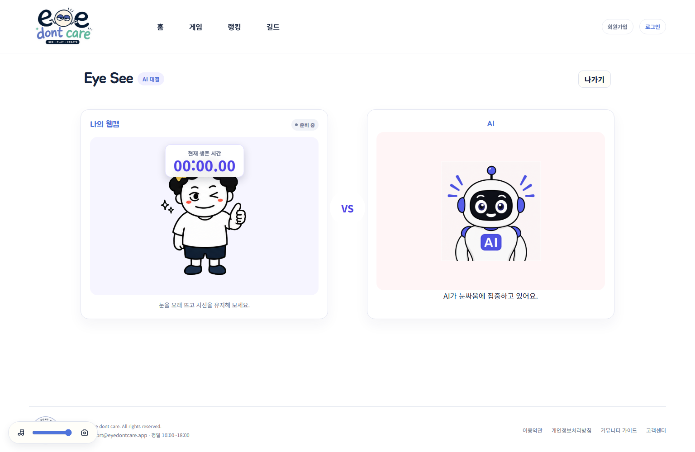
</p>

> 이 저장소는 포트폴리오용 아카이브입니다. 소스 코드와 운영 환경 설정은 포함하지 않습니다.

**바로 보기:** [게임 5종](#게임-5종) · [서비스 흐름](#서비스-흐름) · [화면](#화면) · [기술 스택](#기술-스택) · [내가 맡은 일](#내가-맡은-일)

## 게임 5종

| 게임 | 눈으로 하는 일 | 플레이 방식 |
| --- | --- | --- |
| **Eye Hockey** | 시선으로 패들을 움직이고 깜빡여 퍽 타격 | AI · 친구 · 랜덤 |
| **Eye See** | 눈을 뜬 상태를 오래 유지 | 솔로 · AI · 친구 · 랜덤 |
| **Eye Draw** | 시선으로 그림을 그리고 AI 채점 받기 | AI |
| **Blink the Beat** | 왼쪽·오른쪽 눈을 리듬에 맞춰 깜빡이기 | 솔로 · 친구 · 랜덤 |
| **Eye Show Speed** | 20초 동안 깜빡임 횟수 기록 | 솔로 · 친구 · 랜덤 |

<details>
<summary><strong>게임별 플레이 화면 보기</strong></summary>

### Eye Hockey

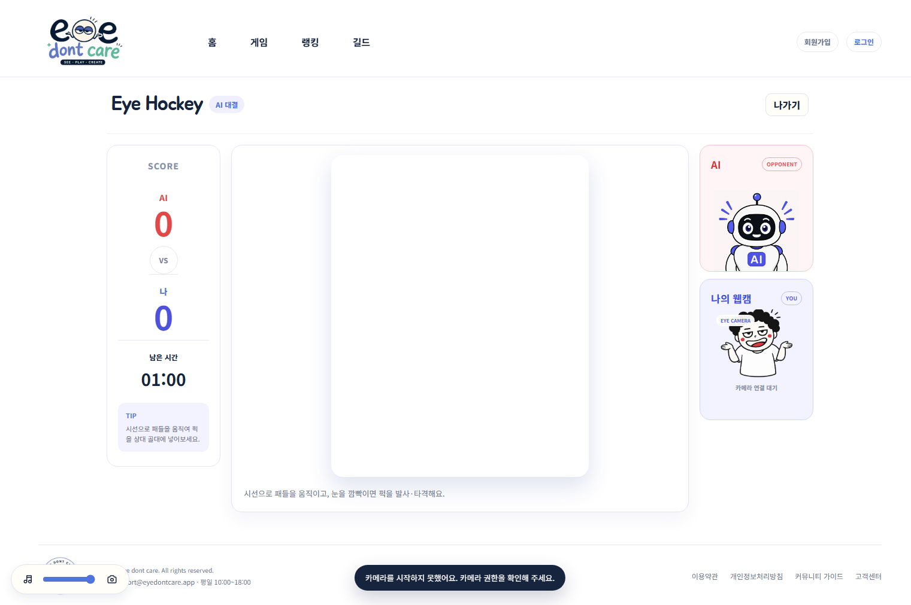

### Eye See


### Eye Draw

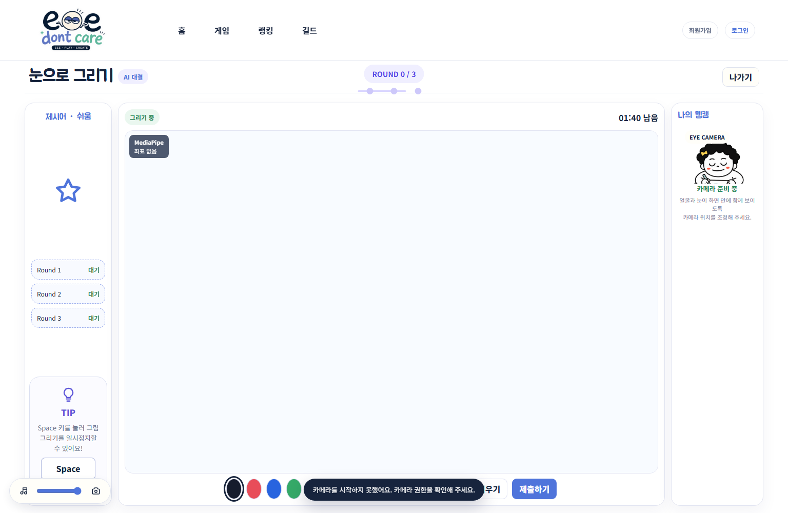

### Blink the Beat

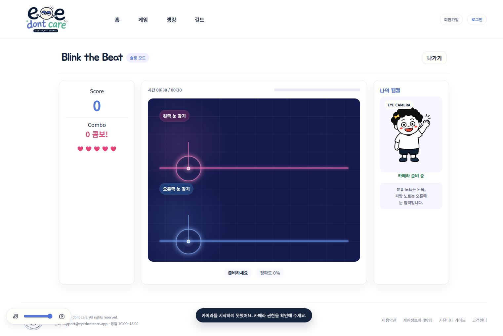

### Eye Show Speed

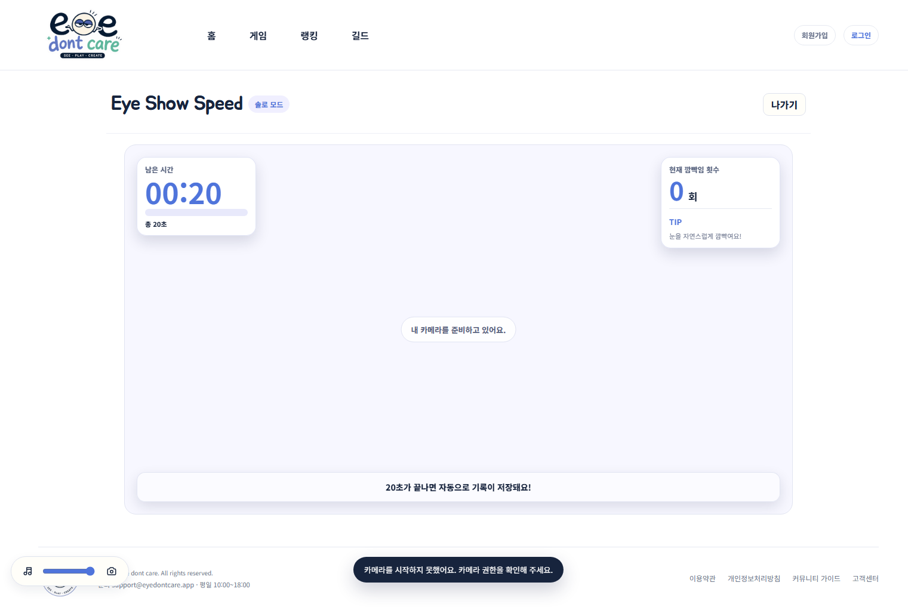

</details>

## 서비스 흐름

```text
로그인 또는 게스트 입장
    → 게임·모드 선택
    → 카메라 연결과 눈 상태 보정
    → 게임 플레이
    → 결과 확인·저장
    → 랭킹·프로필에서 기록 조회
```

친구 대결은 초대코드로 방을 만들고 준비 상태를 동기화합니다. 랜덤 대결은 WebSocket으로 상대를 찾아 대기방에 연결합니다. 게임 중 카메라·음성은 WebRTC, 점수와 게임 상태는 WebSocket으로 주고받습니다.

## 화면

<details open>
<summary><strong>홈 · 게임 목록</strong></summary>

<p align="center">
  
  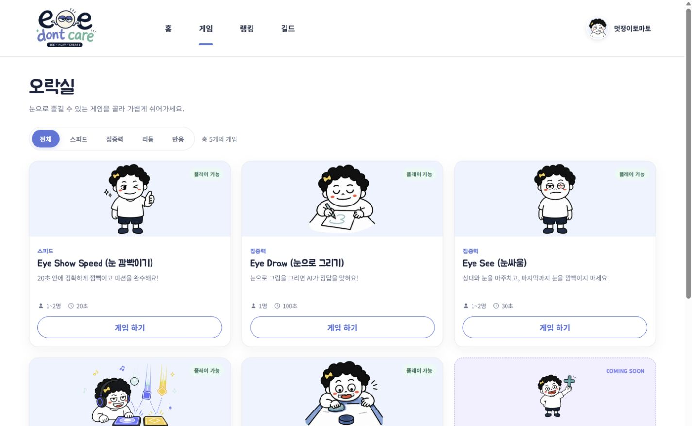
</p>

</details>

<details>
<summary><strong>랭킹 · 커뮤니티 · 프로필</strong></summary>

<p align="center">
  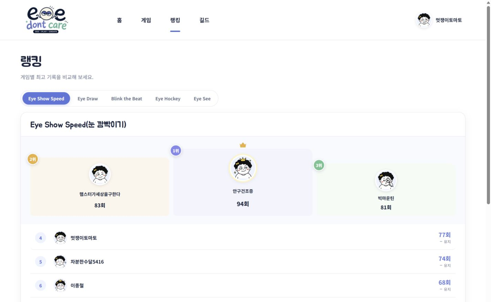
  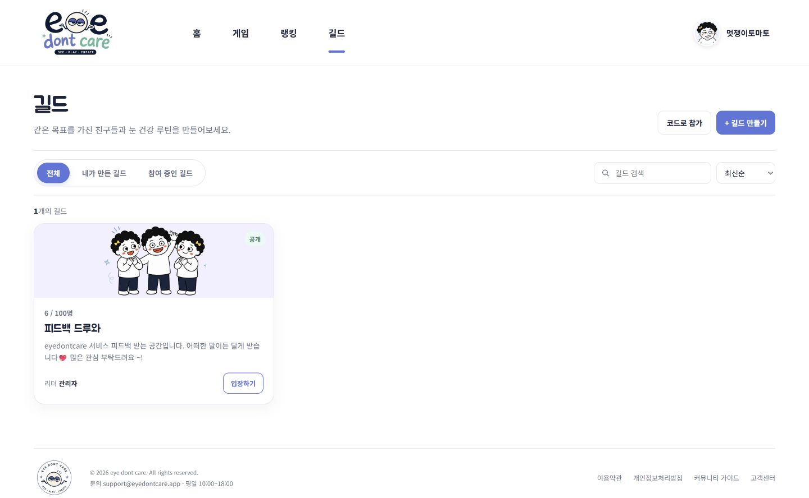
  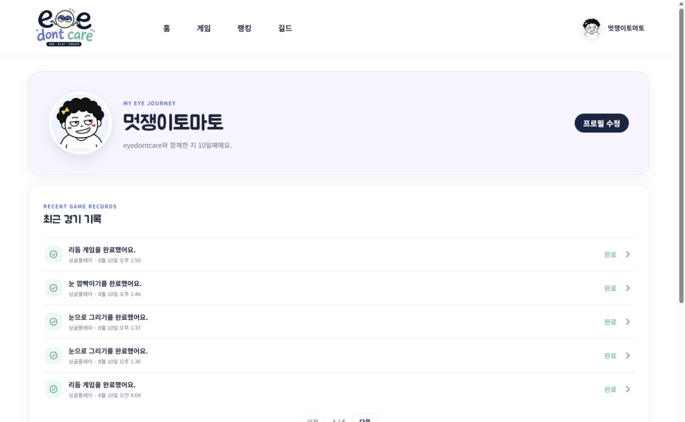
</p>

</details>

더 많은 준비·게임·결과 화면은 [화면 캡처 모음](./portfolio-screenshots/)에서 볼 수 있습니다.

## 기술 스택

| 영역 | 기술 |
| --- | --- |
| **프론트엔드** | Vue 3, TypeScript, Vite, Pinia, Vue Router |
| **시선·눈 인식** | MediaPipe Tasks Vision, SeeSo(Eyedid) SDK |
| **백엔드** | Java 25, Spring Boot 4.1, Spring Data JPA, PostgreSQL 15, Redis 7 |
| **실시간 통신** | WebSocket, LiveKit·OpenVidu 기반 WebRTC |
| **운영·연동** | Docker Compose, Nginx, Jenkins, Kakao OAuth 2.0, AI 채점 API |

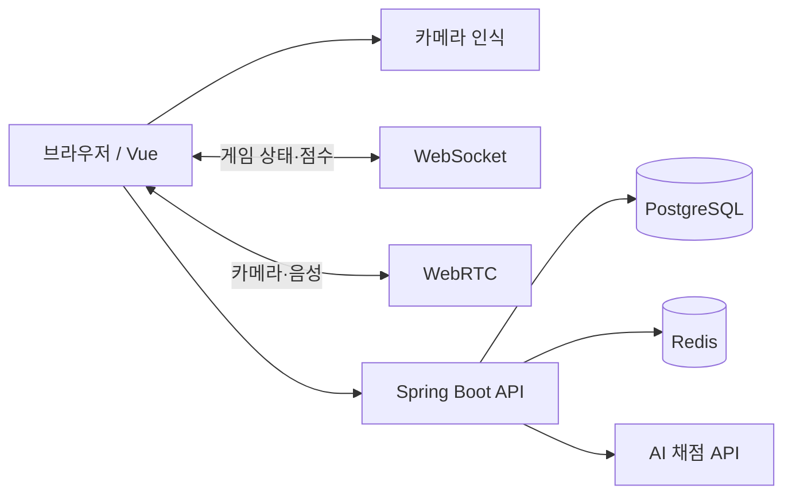

## 내가 맡은 일

**김태은 · 게임 플레이·결과 UI**

- 게임방과 플레이 화면을 구현하고 카메라 입력 상태가 화면에 드러나도록 구성했습니다.
- 캘리브레이션 과정과 카메라 연결·오류 안내를 다듬었습니다.
- 리듬 게임의 입력 판정 피드백과 결과 화면을 개발했습니다.
- 무승부·상대 이탈·재플레이 등 대결 결과에 따른 화면 흐름을 정리했습니다.

### 설계하며 신경 쓴 점

| 상황 | 적용한 방식 |
| --- | --- |
| 카메라 권한이나 얼굴 인식에 실패 | 연결·미검출·보정 중·재연결 필요 상태를 구분해 안내 |
| 미리보기와 게임 화면의 방향이 다름 | 시선 좌표 변환과 좌우 방향 보정을 게임 영역별로 적용 |
| 대결 중 상대가 이탈하거나 새로고침 | 정상 종료와 이탈 종료를 구분해 결과 화면에 반영 |
| 게임마다 눈 입력 방식이 다름 | 공통 인식 결과를 게임별 입력 이벤트로 변환 |

<details>
<summary><strong>팀 협업과 담당 영역 보기</strong></summary>

아래 내용은 프로젝트 커밋과 기능 영역을 기준으로 정리한 요약입니다. 외부 공개 전 팀원별 이름과 담당 범위를 확인해야 합니다.

| 팀원 | 담당 영역 |
| --- | --- |
| 정재현 | 서비스 통합, 실시간 미디어, 시선 기능, 배포 |
| 장미지 | 인증, 대기방, 매칭, 백엔드 |
| 김진광 | 랭킹, 결과, 커뮤니티, 게임 동기화 |
| 김보경 | 프론트엔드 UI/UX, 게임 보조 기능 |
| 김태은 | 게임 플레이, 캘리브레이션 UX, 결과 UI |
| 박호진 | 게임 기능 협업, QA |

</details>

## 공개 범위

이 저장소에는 프로젝트 설명과 화면 캡처만 담았습니다. 프론트엔드·백엔드 소스, 환경변수, API·라이선스 키, 운영 서버 접속 정보는 포함하지 않습니다. 배포 서비스는 운영이 유지되는 동안 [eyedontcare.shop](https://eyedontcare.shop)에서 확인할 수 있습니다. 카메라 게임은 HTTPS와 브라우저 카메라 권한이 필요하며, 조명과 카메라 위치에 따라 인식 정확도가 달라질 수 있습니다.
